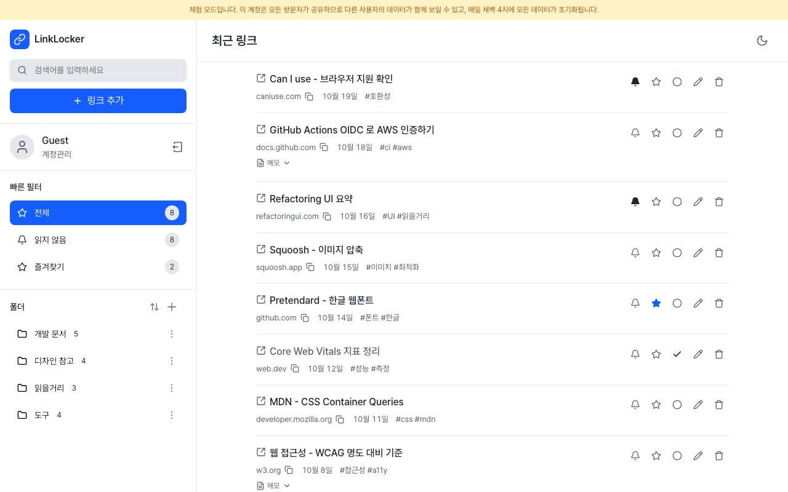
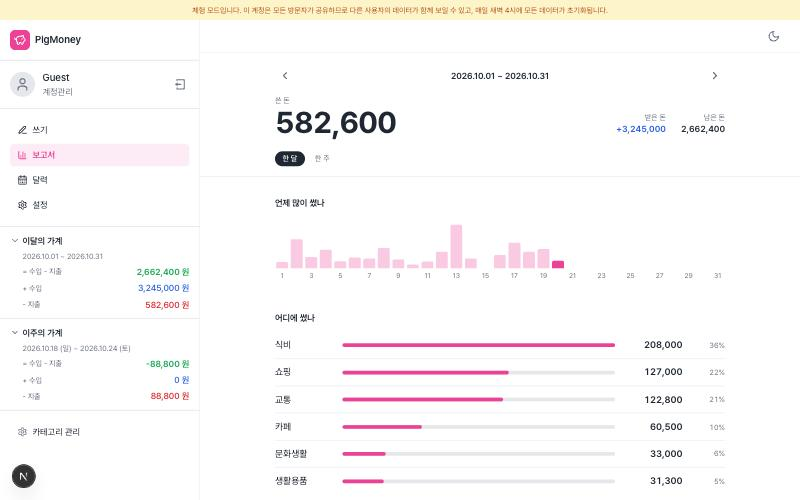

# MiniMoku

필요한 기능이 생길 때마다 하나씩 만들어 붙인 개인용 웹앱입니다. 매일 쓰고 있습니다.

**https://www.minimoku.net** — 로그인 없이 둘러볼 수 있습니다.

| 서비스               | 경로        | 하는 일                                                                                    |
| -------------------- | ----------- | ------------------------------------------------------------------------------------------ |
| **LinkLocker**       | `/link`     | 나중에 읽을 링크를 폴더로 모아 둡니다. 태그·검색, 읽음·즐겨찾기 표시, 링크마다 메모        |
| **PigMoney**         | `/pigmoney` | 수입과 지출을 날짜별 장부로 적습니다. 달력, 카테고리별 보고서, 월 시작일·주 시작 요일 설정 |
| **텔레그램 Todo 봇** | —           | 텔레그램에서 명령으로 할 일을 넣으면 정한 시각에 알림이 옵니다                             |

 

## 만든 방식

기능보다 오래 남는 건 결정이라고 생각합니다. 이 프로젝트에서 내린 것 중 넷을 적습니다.

**조회도 서버 액션에서 직접.** 데이터 조회용 API 경로를 두지 않고 서버 액션이 Prisma 로 바로
읽습니다. 사용자 식별자를 세션에서만 얻으므로, 외부 입력으로 조회 범위를 정할 수 있는 경로가 애초에
생기지 않습니다. (전에는 `?userId=` 쿼리만 믿는 공개 경로가 있었습니다.)

**조회는 캐시하고, 바꾼 사람에게는 즉시 보이게.** Next 의 Cache Components 로 조회를 사용자별 태그를
달아 캐시하고, 변경 액션은 `updateTag` 로 그 태그만 즉시 만료시킵니다. 수명은 한 시간으로 묶었습니다
— 앱을 거치지 않는 변경(체험 계정을 매일 새벽에 되돌리는 Lambda)도 반영돼야 하기 때문입니다.

**색은 팔레트에서 한 번만.** 라이트·다크 값을 한 벌로 두고 토큰 이름은 매핑만 합니다. 글자용과 면용
색을 나눠 두는데, 한 값으로는 양쪽의 명도 대비를 동시에 만족시킬 수 없어서입니다 — 흰 글자를
올리려면 어두워야 하고, 어두운 배경 위 글자로 쓰려면 밝아야 합니다.

**배포 키를 두지 않는 자동 배포.** 주기 실행용 Lambda 는 GitHub Actions 가 OIDC 로 역할을 빌려
배포합니다. 저장소에 AWS 키가 없고, 스키마가 바뀌면 재배포가 필요한 함수를 자동으로 가려냅니다.

## 품질

실제 서비스에 Lighthouse 를 돌린 결과입니다 (2026-10-21).

| 화면            | 성능 | 접근성 | 권장사항 | SEO |
| --------------- | ---- | ------ | -------- | --- |
| 홈 (데스크톱)   | 100  | 100    | 100      | 100 |
| 홈 (모바일)     | 97   | 100    | 100      | 100 |
| LinkLocker      | 99   | 100    | 100      | 100 |
| PigMoney 보고서 | 100  | 100    | 100      | 100 |

- **E2E 테스트 33개** (Playwright) — 캐시가 변경을 바로 반영하는지, 접근성 위반이 없는지(일곱 화면 ×
  라이트·다크를 axe 로), 모바일 드로어, 로그인 후 돌아갈 경로까지 고정해 둡니다.
- **Storybook** — 표시용 컴포넌트를 비어 있을 때·한쪽으로 쏠렸을 때처럼 손으로 만들기 번거로운
  상태까지 담아 두고, 스토리마다 접근성 검사를 돌립니다.
- 접근성은 색 대비뿐 아니라 **랜드마크와 제목 단계**까지 봅니다. 스크린리더로 "본문으로 건너뛰기" 가
  되어야 한다는 뜻입니다.

## 기술 스택

Next.js 16 (App Router · Cache Components) · React 19 · TypeScript 6 · Tailwind CSS 4 + shadcn/ui ·
Zustand 5 · Zod 4 · Prisma 6 (Supabase PostgreSQL) · NextAuth 4 · Playwright · Storybook 10 · AWS
Amplify + Lambda

## 실행

```bash
npm install
npm run dev          # 개발 서버 (localhost:3000)
npm run test:e2e     # E2E 테스트
npm run storybook    # 컴포넌트 카탈로그 (localhost:6006)
npm run build
```

환경변수는 `.env.development` / `.env.production` 에 둡니다. 필요한 키 목록과 운영상 주의점은
[`.claude/CLAUDE.md`](.claude/CLAUDE.md) 에 정리돼 있습니다.

## 문서

- [`.claude/CLAUDE.md`](.claude/CLAUDE.md) — 구조·규칙·운영 주의점 (가장 자세합니다)
- [`docs/frontend-portfolio-review.md`](docs/frontend-portfolio-review.md) — 스스로 짚은 문제와 고친
  순서
- [`docs/hosting-and-deployment.md`](docs/hosting-and-deployment.md) — 호스팅 구조·요금·장애 기록
- [`docs/pigmoney/`](docs/pigmoney/) — PigMoney 기획과 구현
